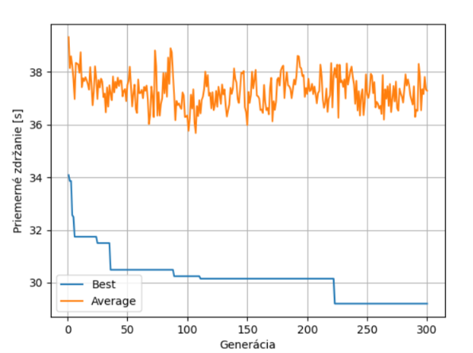
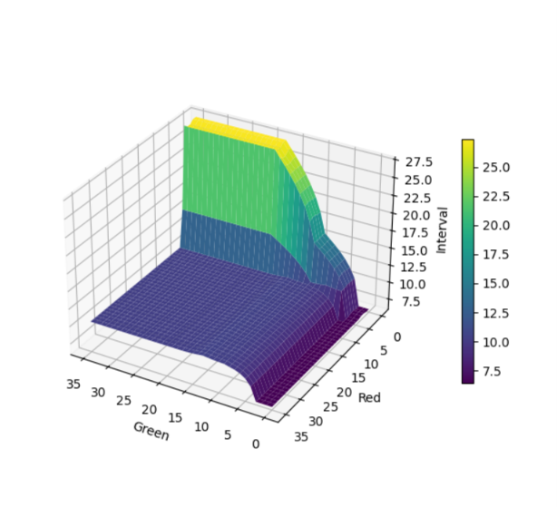

# 01 - Hranice membership funkcií (300 generácií × 30 jedincov)

## Parametre genetického algoritmu

| parameter | hodnota |
|---|--|
| veľkosť populácie | 30|
| počet generácií | 300|
| elitní jedinci | 2|
| noví náhodní jedinci | 5 v každej generácii |
| selekcia | turnajový výber (2 jedinci)|
| kríženie | jednobodové|
| mutácia | bit-flip, 10 %|
| jedinec | 12 génov × 3 bity (4 body pre green, red, interval)|
| fitness | priemerné zdržanie vozidla|

## Parametre simulácie - Vissim

| parameter | hodnota |
|---|---|
| križovatka | `vissim/Pezinok_fixed.inpx` |
| dĺžka simulácie | 500 s |
| vyhodnotenie od | 120 s|
| SimRes | 5 |
| seed | 42 |
| intenzita dopravy | 900 voz/h|
| rozsah vstupov | 0–35 áut|
| rozsah výstupu | 5–36 s|

## Výsledok

**Priemerné zdržanie: 29.20 s**

| premenná | body [p1, p2, p3, p4] |
|---|---|
| green | [2, 3, 9, 17] |
| red | [1, 4, 5, 6] |
| interval | [6, 9, 16, 22] |

Výsledné membership funkcie:

| | few / short | normal | a lot / long | very many / very long |
|---|---|---|---|---|
| green | [0, 0, 2, 3] | [2, 3, 9] | [3, 9, 17] | [9, 17, 35, 35] |
| red | [0, 0, 1, 4] | [1, 4, 5] | [4, 5, 6] | [5, 6, 35, 35] |
| interval | [5, 5, 6, 9] | [6, 9, 16] | [9, 16, 22] | [16, 22, 36, 36] |

### Priebeh fitness

### 3D plocha fuzzy systému
