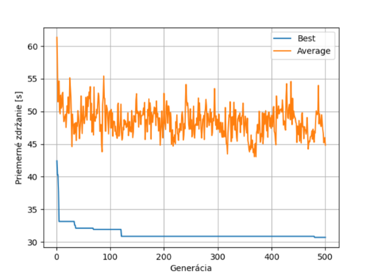
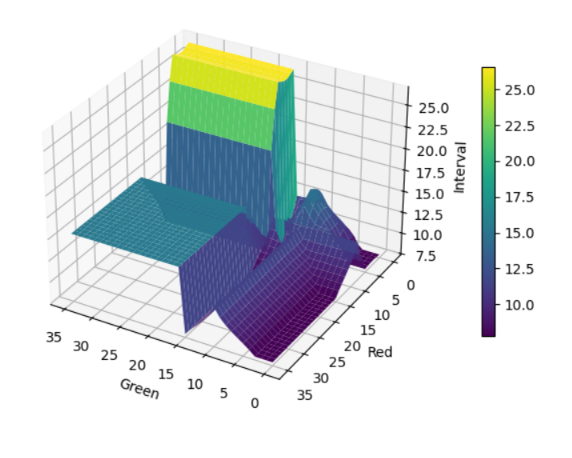

# 02 - Hranice membership funkcií + pravidlá (500 generácií × 30 jedincov)

## Parametre genetického algoritmu

| parameter | hodnota |
|---|--|
| veľkosť populácie | 30|
| počet generácií | 500|
| elitní jedinci | 2|
| noví náhodní jedinci | 5 v každej generácii|
| selekcia | turnajový výber (2 jedinci)|
| kríženie | jednobodové|
| mutácia | bit-flip, 5 %|
| jedinec | 28 génov × 3 bity (12 génov = body MF, 16 génov = výstupy pravidiel)|
| gén pravidla | 3 bity => číslo 0-7 => % 4 => short / normal / long / very long|
| fitness | priemerné zdržanie vozidla|

## Parametre simulácie - Vissim

| parameter | hodnota |
|---|---|
| križovatka | `vissim/Pezinok_fixed.inpx` |
| dĺžka simulácie | 500 s |
| vyhodnotenie od | 120 s |
| SimRes | 5 |
| seed | 42 |
| intenzita dopravy | 900 voz/h |
| rozsah vstupov | 0–35 áut |
| rozsah výstupu | 5–36 s |

## Výsledok

**Priemerné zdržanie: 30.70 s**

| premenná | body [p1, p2, p3, p4] |
|---|---|
| green | [3, 10, 15, 16] |
| red | [0, 5, 8, 15] |
| interval | [10, 11, 15, 20] |

Výsledné membership funkcie:

| | few / short | normal | a lot / long | very many / very long |
|---|---|---|---|---|
| green | [0, 0, 3, 10] | [3, 10, 15] | [10, 15, 16] | [15, 16, 35, 35] |
| red | [0, 0, 0, 5] | [0, 5, 8] | [5, 8, 15] | [8, 15, 35, 35] |
| interval | [5, 5, 10, 11] | [10, 11, 15] | [11, 15, 20] | [15, 20, 36, 36] |

Výsledné pravidlá (v zátvorke naše ručne nastavené pravidlo):

| green \ red | few | normal | a lot | very many |
|---|---|---|---|---|
| **few** | short | short | normal (short) | short |
| **normal** | normal | long (normal) | normal | normal (short) |
| **a lot** | normal (long) | short (long) | normal | short (normal) |
| **very many** | very long | very long | short (long) | long (normal) |

### Priebeh fitness

### 3D plocha fuzzy systému
