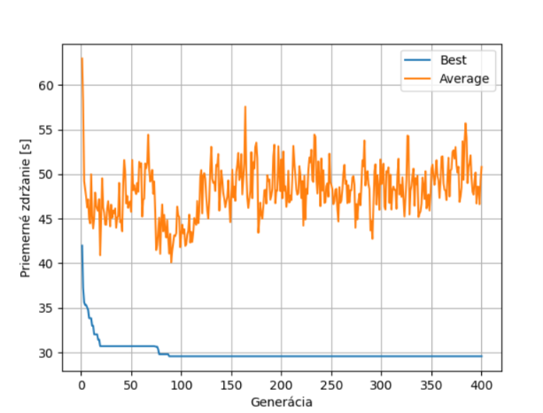
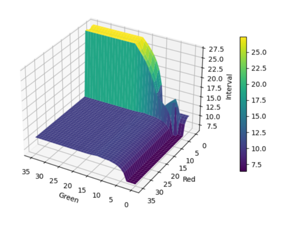

# 04 - Pravidlá s pevnými membership funkciami (400 generácií × 30 jedincov)

## Parametre genetického algoritmu

| parameter | hodnota |
|---|---|
| veľkosť populácie | 30 |
| počet generácií | 400 |
| elitní jedinci | 2 (zúčastňujú sa turnaja) |
| noví náhodní jedinci | 5 v generácii, iba ak sa 30+ generácií nenašlo lepšie riešenie |
| selekcia | turnajový výber (2 jedinci) |
| kríženie | jednobodové |
| mutácia | bit-flip, 10 % |
| jedinec | 16 génov × 2 bity (výstupy 16 pravidiel) |
| gén pravidla | 2 bity => 0 - short, 1 - normal, 2 - long, 3 - very long |
| prvá generácia | 30 náhodných jedincov |
| fitness | priemerné zdržanie vozidla |

## Parametre simulácie - Vissim

| parameter | hodnota |
|---|---|
| križovatka | `vissim/Pezinok_fixed.inpx` |
| dĺžka simulácie | 500 s |
| vyhodnotenie od | 120 s |
| SimRes | 5 |
| seed | 42 |
| intenzita dopravy | 900 voz/h |
| rozsah vstupov | 0–35 áut |
| rozsah výstupu | 5–36 s |

## Pevné membership funkcie (z experimentu 01)

| premenná | body [p1, p2, p3, p4] |
|---|---|
| green | [2, 3, 9, 17] |
| red | [1, 4, 5, 6] |
| interval | [6, 9, 16, 22] |

## Výsledok

**Priemerné zdržanie: 29.57 s**

Výsledné pravidlá (v zátvorke ručne nastavené pravidlo):

| green \ red | few | normal | a lot | very many |
|---|---|---|---|---|
| **few** | normal (short) | short | short | short |
| **normal** | normal | long (normal) | short (normal) | short |
| **a lot** | short (long) | normal (long) | long (normal) | normal |
| **very many** | very long | very long | very long (long) | normal |

### Priebeh fitness

### 3D plocha fuzzy systému

