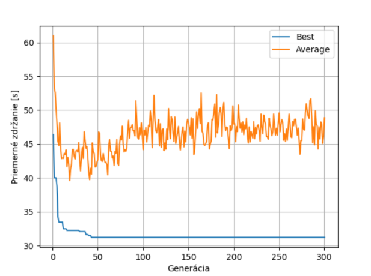
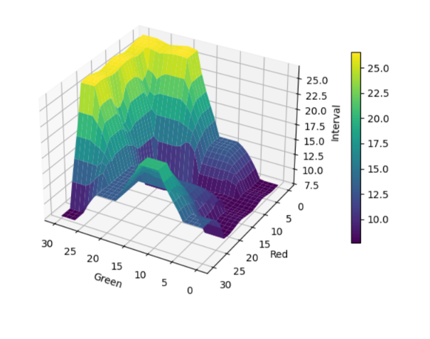

# 05 - Pravidlá s pôvodnými membership funkciami (300 generácií × 30 jedincov)

## Parametre genetického algoritmu

| parameter | hodnota |
|---|---|
| veľkosť populácie | 30 |
| počet generácií | 300 |
| elitní jedinci | 2 (zúčastňujú sa turnaja) |
| noví náhodní jedinci | 5 v generácii, iba ak sa 30+ generácií nenašlo lepšie riešenie |
| selekcia | turnajový výber (2 jedinci) |
| kríženie | jednobodové |
| mutácia | bit-flip, 10 % |
| jedinec | 16 génov × 2 bity (výstupy 16 pravidiel) |
| gén pravidla | 2 bity => 0 - short, 1 - normal, 2 - long, 3 - very long |
| prvá generácia | 30 náhodných jedincov |
| fitness | priemerné zdržanie vozidla |

## Parametre simulácie - Vissim

| parameter | hodnota |
|---|---|
| križovatka | `vissim/Pezinok_fixed.inpx` |
| dĺžka simulácie | 500 s |
| vyhodnotenie od | 120 s |
| SimRes | 5 |
| seed | 42 |
| intenzita dopravy | 900 voz/h |
| rozsah vstupov | 0–30 áut |
| rozsah výstupu | 5–30 s |

## Pevné membership funkcie (pôvodné, ručne navrhnuté)

| | few / short | normal | a lot / long | very many / very long |
|---|---|---|---|---|
| green | [0, 0, 3, 9] | [4, 11, 18] | [13, 20, 27] | [22, 27, 30, 30] |
| red | [0, 0, 3, 9] | [4, 11, 18] | [13, 20, 27] | [22, 27, 30, 30] |
| interval | [5, 5, 8, 12] | [7, 13, 19] | [14, 20, 26] | [21, 26, 30, 30] |

## Výsledok

**Priemerné zdržanie: 31.22 s**

Výsledné pravidlá (v zátvorke ručne nastavené pravidlo):

| green \ red | few | normal | a lot | very many |
|---|---|---|---|---|
| **few** | short | short | short | normal (short) |
| **normal** | normal | short (normal) | normal | long (short) |
| **a lot** | very long (long) | short (long) | normal | normal |
| **very many** | very long | very long | very long (long) | short (normal) |

### Priebeh fitness

### 3D plocha fuzzy systému
