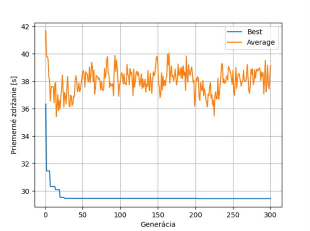
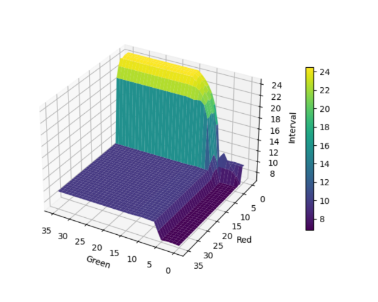

# 06 - Hranice membership funkcií s pravidlami z experimentu 04 (300 generácií × 30 jedincov)
  
## Parametre genetického algoritmu
 
| parameter | hodnota |
|---|---|
| veľkosť populácie | 30 |
| počet generácií | 300 |
| elitní jedinci | 2 |
| noví náhodní jedinci | 5 v každej generácii |
| selekcia | turnajový výber (2 jedinci) |
| kríženie | jednobodové |
| mutácia | bit-flip, 10 % |
| jedinec | 12 génov × 3 bity (4 body pre green, red, interval) |
| prvá generácia | 30 náhodných jedincov |
| fitness | priemerné zdržanie vozidla |
 
## Parametre simulácie - Vissim
 
| parameter | hodnota |
|---|---|
| križovatka | `vissim/Pezinok_fixed.inpx` |
| dĺžka simulácie | 500 s |
| vyhodnotenie od | 120 s |
| SimRes | 5 |
| seed | 42 |
| intenzita dopravy | 900 voz/h |
| rozsah vstupov | 0–35 áut |
| rozsah výstupu | 5–36 s |
 
## Pravidlá z experimentu 04:
 
| green \ red | few | normal | a lot | very many |
|---|---|---|---|---|
| **few** | normal | short | short | short |
| **normal** | normal | long | short | short |
| **a lot** | short | normal | long | normal |
| **very many** | very long | very long | very long | normal |
 
## Výsledok
 
**Priemerné zdržanie: 29.45 s**
 
| premenná | body [p1, p2, p3, p4] |
|---|---|
| green | [0, 5, 7, 14] |
| red | [1, 2, 4, 7] |
| interval | [8, 9, 12, 14] |
 
Výsledné membership funkcie:
 
| | few / short | normal | a lot / long | very many / very long |
|---|---|---|---|---|
| green | [0, 0, 0, 5] | [0, 5, 7] | [5, 7, 14] | [7, 14, 35, 35] |
| red | [0, 0, 1, 2] | [1, 2, 4] | [2, 4, 7] | [4, 7, 35, 35] |
| interval | [5, 5, 8, 9] | [8, 9, 12] | [9, 12, 14] | [12, 14, 36, 36] |

### Priebeh fitness

 
### 3D plocha fuzzy systému

 